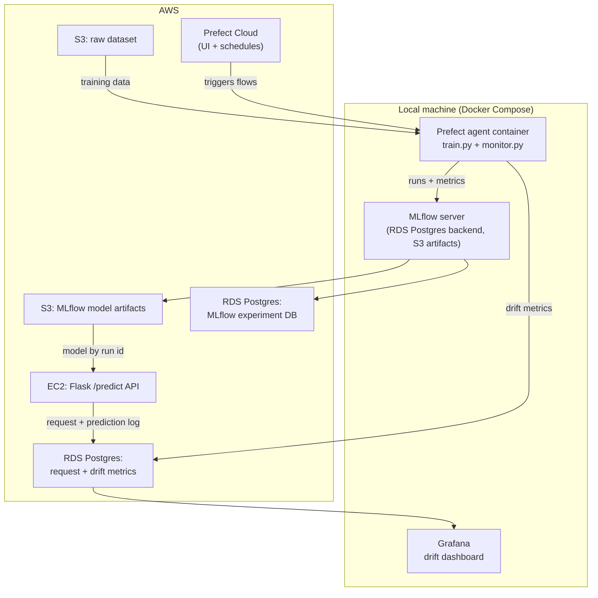

# MLOps Bank Deposit Prediction

An end-to-end MLOps pipeline built from the [MLOps Zoomcamp](https://github.com/DataTalksClub/mlops-zoomcamp) course. It trains an XGBoost model on the [Bank Marketing](https://www.kaggle.com/datasets/henriqueyamahata/bank-marketing?select=bank-additional-full.csv) dataset, tracks every run in MLflow (RDS Postgres backend, S3 artifacts), serves the best model behind a Flask/Waitress `/predict` API on AWS EC2, and continuously monitors the live model for data drift with Evidently + Grafana.

## Table of Contents
- [Problem Statement](#problem-statement)
- [Architecture](#architecture)
- [Tools Used](#tools-used)
- [Project Flow](#project-flow)
  - [1. Data Retrieval](#1-data-retrieval)
  - [2. Train and Track the Machine Learning Experiment](#2-train-and-track-the-machine-learning-experiment)
  - [3. Model Selection and Deployment](#3-model-selection-and-deployment)
  - [4. Front-End API Service](#4-front-end-api-service)
  - [5. Performance Monitoring](#5-performance-monitoring)
- [Repository Layout](#repository-layout)
- [Prerequisites](#prerequisites)
- [Quickstart](#quickstart)
- [Cleanup](#cleanup)
- [Further Improvements](#further-improvements)

## Problem Statement
Traditionally, reaching out to customers to gauge their interest in a bank term deposit involves resource-intensive methods such as individual phone calls. With the vast number of customer accounts, this approach proves time-consuming and inefficient. To address this challenge and optimize the allocation of resources and time, we propose a Machine Learning solution. By training the model on historical customer data, including information gathered during the account creation process, and leveraging insights from previous marketing campaigns, we aim to predict whether a customer is likely to respond positively or negatively to a term deposit offer. This predictive capability empowers stakeholders to strategically target the most receptive audience, enhancing the efficacy of marketing campaigns.

The model is exposed as an API endpoint that the marketing department can call with lists of customer records and receive a predicted subscription probability for each. The whole lifecycle — training, deployment, and monitoring — is automated and reproducible, which is where the MLOps principles come in.

## Architecture



- **Prefect** orchestrates the `train` and `monitor` flows. The flows run in a local Docker container whose agent registers with Prefect Cloud, so runs can be triggered and inspected from the Cloud UI.
- **MLflow** tracks experiments. Its backend store is an RDS Postgres database; model artifacts live in S3.
- The **Flask API** runs on the Terraform-provisioned EC2 instance. It loads the selected model once from S3 at startup and logs every request (input + prediction) to the monitoring database.
- The **monitor** flow compares those logged predictions against the reference dataset in S3 with Evidently and writes drift metrics that **Grafana** renders.

## Tools Used

- Orchestration: [Prefect 2](https://www.prefect.io/) (Cloud)
- Machine Learning: [XGBoost](https://xgboost.readthedocs.io/), [scikit-learn](https://scikit-learn.org/)
- Experiment Tracking: [MLflow](https://mlflow.org/) (Postgres backend, S3 artifacts)
- Model Serving: [Flask](https://flask.palletsprojects.com/) + [Waitress](https://docs.pylonsproject.org/projects/waitress/)
- Model Monitoring: [Evidently](https://docs.evidentlyai.com/) + [Grafana](https://grafana.com/)
- Infrastructure as Code: [Terraform](https://developer.hashicorp.com/terraform)
- Cloud: AWS (S3, RDS for PostgreSQL, EC2)
- Containerization: [Docker](https://www.docker.com/) + [Docker Compose](https://docs.docker.com/compose/)
- Reproducibility: [GNU Make](https://www.gnu.org/software/make/)

## Project Flow


### 1. Data Retrieval

The Bank Marketing dataset is downloaded from Kaggle into `data/`. `make getdata` adds an `id` column (to simulate customer IDs, which production data would carry) and uploads the file to the raw-data S3 bucket. In production, this data would come from the bank's own database.

### 2. Train and Track the Machine Learning Experiment

The `train` flow (triggered from the Prefect Cloud UI) downloads the dataset from S3, cleans it (age and duration are bucketed identically in training and serving, see `code/features.py`), and runs an XGBoost hyperparameter grid defined in `config/train_params.yaml`. Every run — parameters, metrics (accuracy, F1) and the fitted model — is logged to MLflow, which stores metadata in RDS Postgres and model artifacts in S3.

### 3. Model Selection and Deployment

`make deploy-api` runs `code/deploymodel.py`, which resolves the `ML-xgb` experiment in MLflow, selects the best run by accuracy and F1, records the winning run id in `.env.local`, and starts the API service on the EC2 instance over SSH. In a real team, this step is a human decision: the data science team reviews the new model's metrics in the MLflow UI before promoting it.

### 4. Front-End API Service

The API is a Flask app served by Waitress on the EC2 instance (port 9696). At startup it loads exactly one model from S3, addressed by experiment id and run id, so a redeploy only requires restarting the container with a new run id. `POST /predict` accepts a JSON list of customer records and returns the model version, date and one prediction per record. Every request and its prediction are logged to the monitoring database for drift analysis.

### 5. Performance Monitoring

The `monitor` flow runs on a daily cron via Prefect. It compares the logged live predictions against the reference dataset in S3 with Evidently (column drift, dataset drift, missing values), and writes the metrics to the monitoring database. A provisioned Grafana dashboard renders the metrics so regressions are visible at a glance.

## Repository Layout

```
├── code/            # Prefect flows, deploy script, Flask API, shared modules
│   ├── features.py  #   age/duration bucketing (train == serving)
│   ├── constants.py #   ports, experiment name, request columns
│   ├── response.py  #   /predict response shaping
│   └── fixtures/    #   sample API requests
├── config/          # train grid, Grafana provisioning + dashboard
├── data/            # raw dataset (gitignored, download from Kaggle)
├── docker/          # Dockerfiles: Prefect agent, MLflow server, web app
├── infra/           # Terraform: VPC, RDS x2, EC2
├── key/             # generated SSH keypair (gitignored)
├── other/           # step-by-step setup guides with screenshots
├── requirements/    # pinned dependencies per image
├── tests/           # pytest suite
├── Makefile         # single entry point for every step
└── docker-compose.yml
```

## Prerequisites

1. An [AWS account](other/AWSAccount/README.md) with an IAM user that can create S3 buckets and RDS/EC2 resources.
2. A [Prefect Cloud account](other/PrefectAccount/README.md) with an API key.
3. Local tooling: Python 3.11, GNU Make, the [AWS CLI](https://aws.amazon.com/cli/), Terraform 1.x, Docker with Compose.
4. Terraform remote state: the config in `infra/versions.tf` expects an S3 bucket `mlop-terraform-state` and a DynamoDB table `mlop-terraform-locks` (region `ap-southeast-1`). Create them once with the AWS console or CLI before the first `terraform init`.

Copy `.env.example` to `.env` and fill in real values (unquoted). `make infra-prep` and `make deploy-api` additionally write generated values (DB endpoints, run id) to the gitignored `.env.local`.

## Quickstart

```bash
cp .env.example .env          # fill in credentials, buckets, DB names

make infra-setup              # terraform init + plan
make infra-create             # create VPC, RDS x2, EC2
make infra-prep               # export SSH key, write .env.local, create monitor tables
make getdata                  # add id column, upload dataset to S3

make dockercreate             # build the three images
make dockerupml               # start MLflow server + Prefect agent
# trigger the train flow from the Prefect Cloud UI
make deploy-api               # pick best model, start the API on EC2
make testapi                  # POST sample requests to the running API
make dockerup                 # add the Grafana monitoring stack
```

A full step-by-step version with screenshots lives in [other/Reproduce](other/Reproduce/README.md).

## Cleanup

```bash
make dockerdown               # stop local containers
make infra-down               # destroy EC2, RDS, VPC
make s3delete                 # delete both S3 buckets
```

## Further Improvements
- Move the API, MLflow server and Grafana to separate hosts instead of one VM + local Docker.
- Add hadolint and image scanning to the CI workflow.
- Provision the Terraform state bucket and lock table with infrastructure as code instead of by hand.
